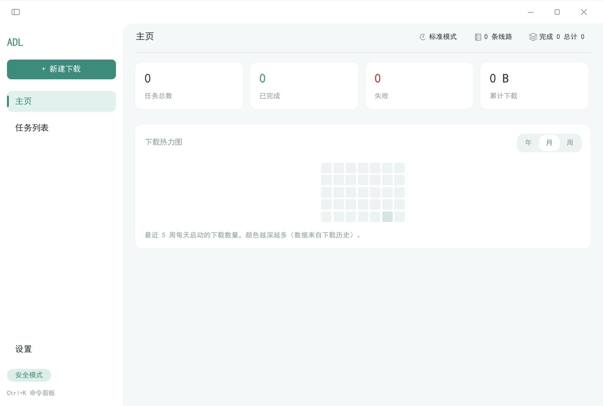
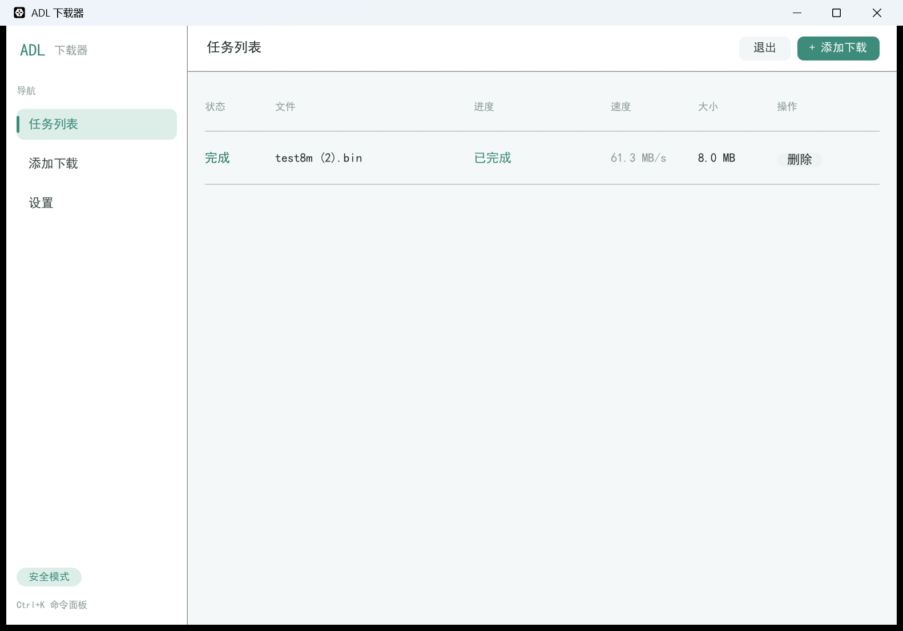
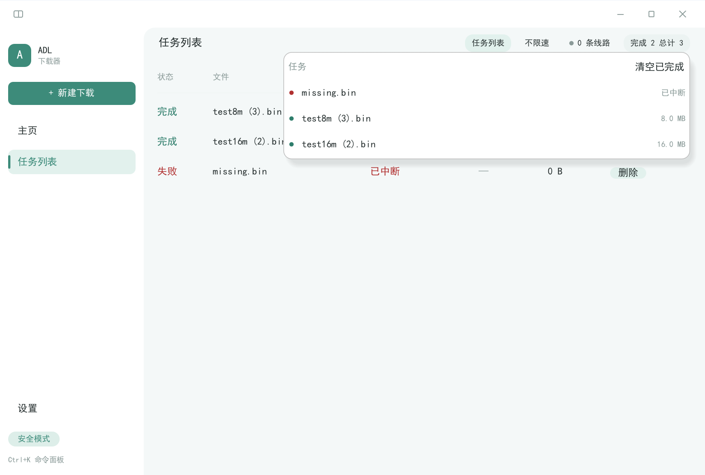
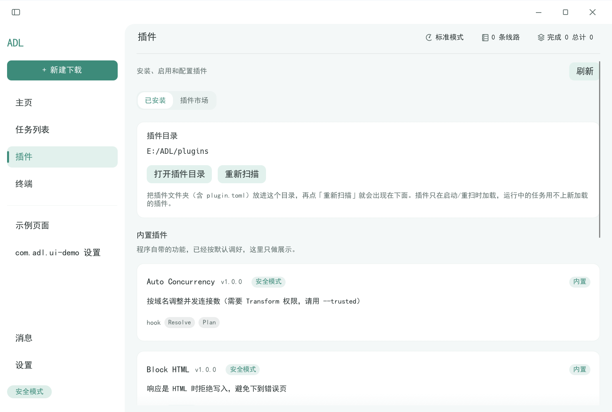
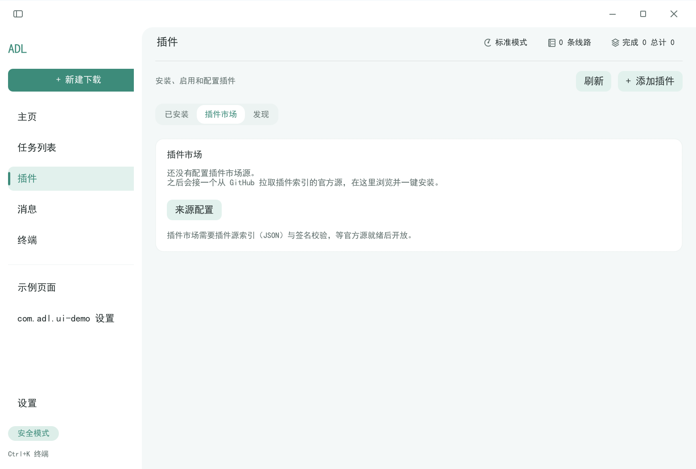
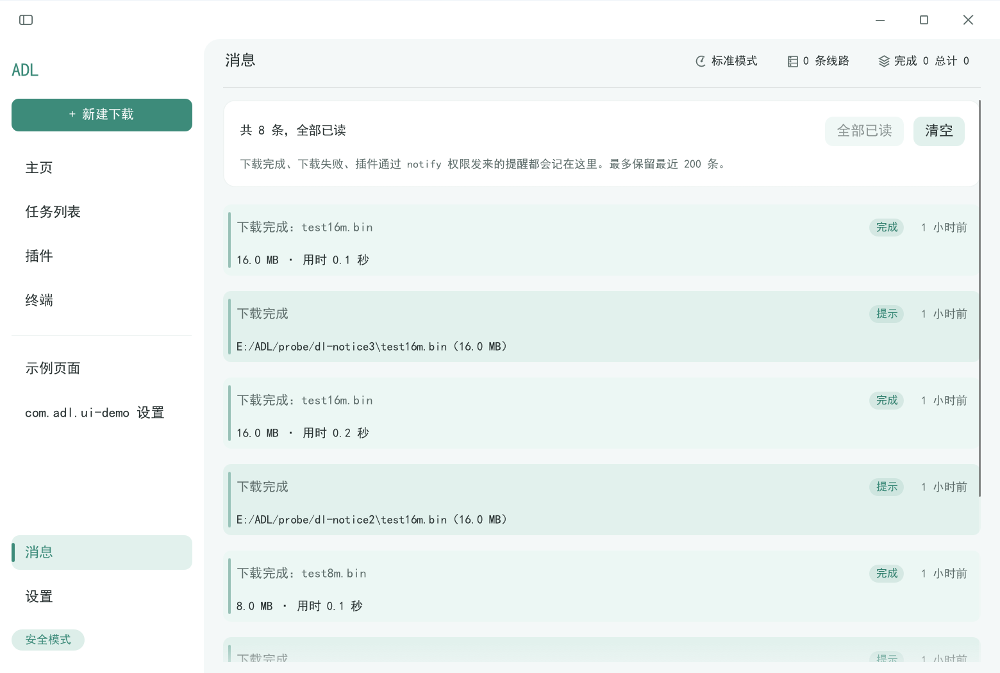
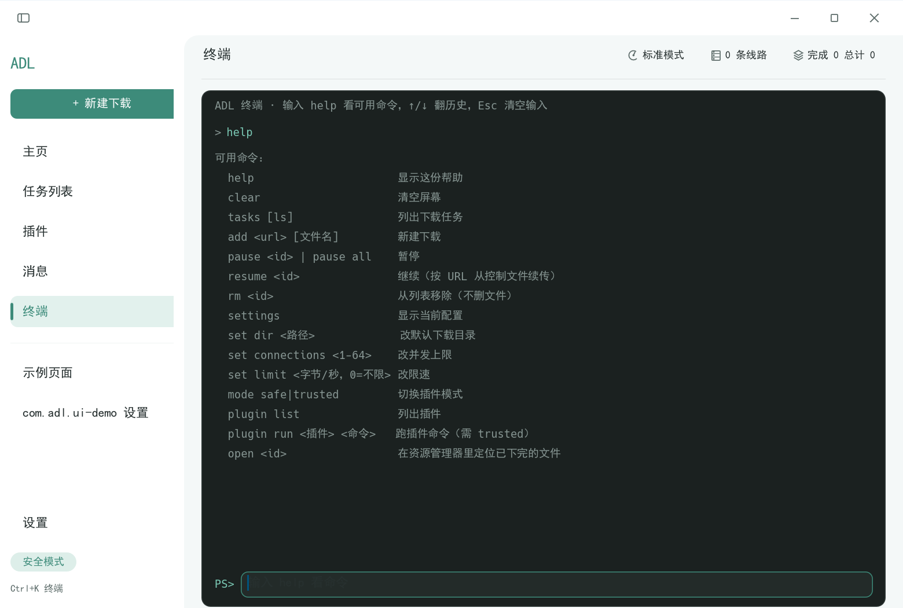

# ADL

一个**小型、快、插件优先**的 HTTPS 下载器。纯 Rust + LLVM，单文件 exe，绿色便携。

> 定位：自用向的轻量下载器（不是 aria2 的替代品）。核心是可靠的多连接分片下载、断点续传，以及一个能真正"插手"下载流程的插件系统。

## 特性

- **多连接分片下载**：把文件切成 1 MiB 的片，多 worker 并发拉取，单写者调度、两阶段抢占（慢连接不拖累整体）。
- **自适应并发**：`-x` 是"期望上限"（1–64，默认 16）。服务器只放行一部分时自动收敛到它接受的量，再隔一阵慢慢试探 +1；不会一直顶着上限猛冲触发反爬。
- **断点续传**：进度记在 `<文件>.adl` 里（原子写）。Ctrl+C 或用 `adl resume <id>` 都能接着下；服务器资源变了（ETag/Last-Modified 不符）会自动整单重下，不会写坏文件。续传粒度 **1 MiB**（位图 1 bit = 1 MiB），单次 Range 请求默认 1–8 MiB 自适应，进度上报每 64 KB 一次。
- **默认冒充浏览器 UA**：很多站点（百度网盘等反盗链）会直接拒绝 aria2 类的基础 UA。可用 `--user-agent` 覆盖；界面上有两处入口 —— 设置页「其它 → User-Agent」填默认值（旁边有「填入 Chrome」按钮，点一下把内置串抄进去再改），「新建下载」弹窗里填单次覆盖。**留空 = 用内置的 Chrome 串**（不是发空 UA）。
- **重名不覆盖**：目标已存在时自动落成 `name (1).ext`；`--restart` 才显式覆盖。
- **服务器校验**：若响应带 `Digest`/`Content-Digest`(sha-256) 或 `Content-MD5`，下载完自动比对，不一致删文件报错；没有就不校验。
- **反爬保护**：连续 60 秒完全没有新字节 → 判定服务器停发（反爬/限速），保存进度后退出，不做无意义狂重试。
- **可选**：`--http1` 强制 HTTP/1.1、`--proxy` 走 HTTP 代理、`--limit` 限速。
- **插件系统（QuickJS）**：用 JavaScript 写，TOML manifest，9 个 hook 点（观察 / 拦截 / 改写）。安全模式默认只允许"观察 + 拦截"；信任模式才允许改写请求。

## 构建

需要 Rust 稳定版（本仓在 `rustc 1.99` / MSVC 工具链上开发）。Windows 上要能离线构建请确保本机有 VS 的 `cl.exe`（`rquickjs` 用它编译内嵌的 QuickJS C 源码）。

```bash
cargo build --release --target x86_64-pc-windows-msvc
# 产物：target/x86_64-pc-windows-msvc/release/adl.exe
```

体积优化已在 `Cargo.toml` 里配好（`opt-level="z"` + `lto="fat"` + `panic="abort"` + `strip`）。默认静态链接 CRT，不依赖 VC++ 运行库。

### 打安装包

有 [Inno Setup](https://jrsoftware.org/isinfo.php) 就能一键出 Windows 安装程序：

```powershell
powershell -NoProfile -ExecutionPolicy Bypass -File scripts\build-installer.ps1
# 产物：dist\ADL-Setup-<版本>.exe
```

脚本依次做：编译 → 拷到 `dist\stage\`（白名单，不带 `.pdb` 和中间产物）→ 给
`adl-gui.exe` / `adl.exe` 签名 → 调 `ISCC.exe`。常用开关：`-NoBuild`（跳过编译）、
`-NoSign`（跳过签名）、`-SignSetup`（连安装程序一起签）、`-Iscc <路径>`。

安装是**按当前用户**装到 `%LOCALAPPDATA%\Programs\ADL`，全程不弹 UAC —— 因为
配置和任务表都放在 exe 同级的 `data\` 里，装进 `Program Files` 反而会因为写不进去
而回退到 `%LOCALAPPDATA%\ADL`。要点机器级安装就改 `installer\adl.iss` 顶部的
`#define InstallScope "machine"`。卸载会删程序但**保留 `data\`**（那是你的任务表和配置）。

安装包还会写 `adl://` 协议注册表项，所以装完立刻能从浏览器拉起 ADL，不必先手动开
一次；Edge 扩展的强制安装项在 `adl.iss` 里由 `EdgeExtPublished` 开关控制，等扩展
上架后置 1 才生效（未上架时指向商店只会让 Edge 报错）。

## 用法

```bash
adl <URL>                       # 下载（默认保存到当前目录）
adl <URL> -d D:\Downloads       # 指定目录
adl <URL> -o movie.mp4          # 指定文件名
adl <URL> -x 16                 # 期望最多 16 连接（默认 16）
adl <URL> --limit 5M            # 限速 5 MB/s
adl <URL> --http1               # 强制 HTTP/1.1
adl <URL> --proxy http://127.0.0.1:7890
adl <URL> -H "Referer: https://example.com/" -H "Cookie: ..."

adl list                        # 列出下载历史
adl resume <id>                 # 继续某条历史（断点续传）
adl remove <id> [--files]       # 删除历史记录（--files 同时删文件）
adl clean                       # 清空已完成的历史
adl config [--init]             # 查看/生成配置文件
```

### 配置文件

所有运行时数据都放在 **exe 同级的 `data/`** 目录里（绿色版整个文件夹拷走即可）：

| 文件 | 内容 |
|---|---|
| `data/config.toml` | 主配置 |
| `data/tasks.json` | 任务列表（重启后自动恢复） |
| `data/history.json` | 完成历史（主页热力图用它） |
| `data/notices.json` | 消息中心 |
| `data/plugin-settings/<id>.json` | 每个插件的独立设置 |
| `data/cache/` | 插件市场下载的临时包 |
| `data/update/` | 自动更新的新 exe |

只有**默认下载目录**跟着系统走（Windows 是「下载」文件夹，Linux 读 `XDG_DOWNLOAD_DIR`）。
`data/` 写不进去时（比如装在 `C:\Program Files`）会回退到 `%LOCALAPPDATA%\ADL` 并打印一行提示。

`adl config --init` 生成的模板：

```toml
dir = ""              # 空 = 系统的「下载」文件夹
connections = 16
chunk_size = 0        # 0 = 按文件大小自动分配
limit = 0             # 字节/秒，0 = 不限
user_agent = ""       # 空 = 内置浏览器 UA
http1 = false
proxy = ""            # 例如 "http://127.0.0.1:7890"
mode = "safe"         # safe | trusted
history_enabled = true
close_action = "tray" # "tray" = 最小化到托盘 | "close" = 退出程序
limit_unit = "auto"   # auto | B/s | KB/s | MB/s | GB/s（只影响显示）
sidebar_collapsed = false
max_concurrent_tasks = 3   # 同时下载几条任务（1-16）
task_sort = "status"       # status | added | name | size | progress
task_filter = "all"        # all | downloading | queued | paused | completed | failed
check_update = true        # 启动时检查 GitHub release
market_url = ""            # 空 = 官方扩展中心的 index.json
```

插件目录固定为 **exe 同级的 `plugins/`**（不再可配）。

命令行的显式参数会覆盖配置里的同名项。

## 原生界面（纯 Rust · egui，不依赖 WebView2）✅ 推荐

`adl-gui.exe` 现在是 **纯 Rust 原生桌面界面**：`eframe`(`egui`)，**同时编入 glow(OpenGL) 与 wgpu 两套渲染后端**，**不需要 WebView2、不需要 Node/vite**，单个 exe，跨 Windows / Linux / macOS。



| 任务列表 | 后台任务下拉 |
|---|---|
|  |  |

| 添加下载（弹窗） | 设置 |
|---|---|
|  |  |

```bash
cargo build --release -p adl-gui
# 产物：target/release/adl-gui.exe（Windows 为 target/x86_64-pc-windows-msvc/release/adl-gui.exe）
```

- **主页**：四张统计卡（任务总数 / 已完成 / 失败 / 累计下载量）+ 下载热力图（年 / 月 / 周三档，数据来自 `history.json`）。
- **左右式外壳**：标题栏（左上折叠键 + 右侧窗口三键）与左侧栏同色连成一整块；内容区浅灰底、**左上角圆角**浮在上面。**不画装饰性分隔线**，边界全靠底色差；只有表头下沿保留一条 0.6px 的极淡线（`palette.hair`），页面标题下用一条更浅的黑色细线（`widgets::rule`）。
- **顶栏 chips**：`标准模式`/限速档位（不限速时显示"标准模式"，点开可选 不限速 / 1·2·5·10 MB/s 直接切换）· `N 条线路`（进行中任务的活跃连接数之和）· `完成 N 总计 M`（点开是任务卡片列表，每行可点直接跳任务列表，右上角可「清空已完成」）。三个 chip 带手画图标（表盘 / 服务器机架 / 菱形堆叠），不依赖字体符号。
- **侧栏**：顶部只写 `ADL` 三个字（无方块图标）→ `+ 新建下载` → 主页 / 任务列表 / 插件 / 终端 → 插件页面（一条细线分隔后紧接，不再有小字分组标题）→ 底部「消息」在「设置」正上方，下面是模式胶囊。**可完全收起**（不留窄轨，收起时品牌字一起消失），收起/展开是 0.22 秒的宽度动画；折叠键图标固定为带竖线的圆角矩形，不随状态变化。
- **常驻「插件」页**（`ADL_TAB=plugins`，代码在独立文件 `crates/adl-gui/src/plugins.rs`）：仿 DSH 布局 —— 顶部「刷新」，下面「已安装 / 插件市场」两个页签。已安装页先把插件分成**内置插件**（`com.adl.*`，程序自带、只展示不给开关 —— 这里面除了真插件，还**把终端也列进来**：它不是 QuickJS 插件、没有 `plugin.toml`，但属于程序自带能力，混在同一组里能一眼看全 ADL 有什么）和**已安装插件**（你自己放进目录的，右侧开关可启停），每项显示版本、描述、生效/被安全模式挡住的 hook、声明的权限；开关直接写回 `config.toml` 并立刻重建插件集合。停用的插件仍留在列表底部，随时能再启用。右上角「从压缩包安装…」直接选一个 zip 就能装（装完自动删包）。**插件市场页读扩展中心的 `index.json`**，列出可装的扩展，点「安装」就下载 → 比对 `sha256` → 解压 → 删包（详见下文「插件」节）。
- **消息中心**：下载完成 / 失败 / 插件 `notify` 提醒都会落成一条消息（`notices.json`，最多 200 条），侧栏入口带未读数；每条消息是 **alert 样式**（级别底色块 + 左侧色条，绿=提示、橙=注意、红=失败），一眼分得清。同时右下角弹一个 4 秒的 toast，点它直接跳到「消息」页。支持「全部已读」「清空」。
- **终端页**（`ADL_TAB=terminal`，Ctrl+K 直达，代码在独立文件 `crates/adl-gui/src/terminal.rs`）：仿 PowerShell 的深色控制台 —— 无描边、**启动只有一行用法提示**（原来照 PowerShell 摆的 `ADL 终端 <版本>` 那行已删）、**`PS ADL>` 提示符**（`PS` 青绿、`ADL>` 蓝；不再显示绝对路径 —— Windows 的 `canonicalize` 会返回 `\\?\E:\...`，屏幕上变成 `//?/E:/...`，而且长路径会把每行都挤断；目录用 `cd` 看）、**输入行就在日志末尾**（跟在最后一条输出后面接着打，不是钉在框底）、**输入的文字与提示符严格同基线**（`TextEdit` 显式 12.5 号 monospace + `Align2::LEFT_CENTER`，否则它会贴在自己 30px 高的框顶，比提示符高出一截）、**边打字边着色**（已识别的命令显绿、`-` 开头显黄、子命令显蓝）、滚动历史最多 500 行，`↑/↓` 翻历史、`Tab` 循环补全、`Esc` 清空输入。**敲过的行连提示符一起留在屏幕上**（`PS ADL> ver` 整条保留，和真 PowerShell 一样）、**`Tab` 补完光标跟到词尾**（补全/翻历史是整行替换，光标会手工复位，不会卡在原来那个字后面）、**空输入时光标不再偏低**（根因是空串的 `LayoutJob` 没有 section、galley 高度为 0，光标拿它居中后整体低半行；在 `term_layouter` 里给空串补一个零宽 section 并钉死 `line_height` 即可）。`help` 输出照 `Get-Help` 的形状排（主题 / 简短说明 / 详细说明 / 参数 / 联机帮助，两空格缩进、同色系，没有色块和卡片）。输出分六级（横幅 / 回显 / 正常 / 提示 / 警告 / 错误），警告单独一色是抄 PowerShell 的多流设计。命令：`help` / `clear` / `tasks` / `add <url> [文件名]` / `pause <id>|all` / `resume <id>` / `rm <id>` / `open <id>` / `cd [目录]` / `history` / `ver` / `settings` / `set dir|connections|limit` / `mode safe|trusted` / `plugin list` / `plugin run <插件> <命令>`。`help` 的命令表与 Tab 补全共用 `TERM_COMMANDS` 一份，不会出现"补得出来但 help 里没有"。








- **添加下载是弹窗**，不再是单独一页；地址框按 Enter 直接开始。
- **无边框窗口、自绘标题栏**：拖动、双击最大化、八向边缘缩放全部自己实现（`with_decorations(false)` 之后系统不再提供）。三个窗口按钮的图标用线段手画，不依赖字体符号。
- **关闭行为可选**：首次点关闭会问「最小化到托盘 / 退出程序」（勾选框在按钮上方），可勾选记住；之后在设置里只能在这两项之间切换（问过就没有"每次询问"这个状态了）。**勾没勾"记住"都一次生效** —— 不会出现"点了退出没反应、还得再点一次 X"。
- **淡入淡出与文本选择**：弹窗（添加下载 / 关闭询问 / 消息 toast）淡入、状态条最后 0.45 秒淡出；全站文本**不可拖选**（只对 `code`/`copy` 的值放开），避免网页式的蓝底选区。
- **换页动效**：侧栏那根 3px 竖条会**跨行滑动**到新选中的按钮（0.18s），按钮底色**整块淡入**（0.16s），页面内容同时淡入（**只做透明度、不做位移** —— 每帧挪几像素会让整屏闪；深色终端与虚拟列表不参与淡入）。三者共用一个时钟，所以看起来是"一次切换"而不是三件事。
- **剪贴板可用**：`eframe` 的 `clipboard` / `links` feature **显式开启**（写在 `default-features = false` 之后，否则整组默认 feature 全关、Ctrl+V 毫无反应也不报错）。下载地址可以一键拷走（任务行的 `⋯` 菜单里「复制下载地址」）。
- **任务操作收进 `⋯` 菜单**：每行只有「暂停/继续」+ 一个手画的三点按钮（`⋯` 在 simhei 里没有字形、会渲染成空方块，所以是画出来的），点开是「打开文件所在位置 / 查看详情… / 复制下载地址 / ─── / 删除任务…」。
- **任务列表工具栏**：搜索框（匹配文件名与地址）+ 状态筛选（全部/下载中/排队中/已暂停/已完成/失败）+ 排序（按状态/添加时间/文件名/大小/进度）+ 右侧「全部暂停 / 全部继续」。默认「按状态」—— **正在下载的在最顶上，已完成的沉底**。筛选与排序会写回配置。
- **批量添加**：新建下载的地址框是多行的，粘贴一坨链接会一行一条一起入队（自动跳过空行和重复行），框下面实时显示识别到几条。
- **任务详情页**：点「查看详情…」进入 `#id` 页面 —— 任务信息 + 8px 圆角进度条 + **分片热力矩阵**（一格 = 1 MiB，绿=已完成、橙=正在下载、灰=未开始）+ **活跃线路列表**（每条区间的起止偏移、已写/总长）。数据来自引擎新增的 `RunInfo`（真实在跑的区间，不是按并发数平分的假数据）。
- **删除会问要不要连文件一起删**：弹窗里两个勾选框（删本地文件 / 记住我的选择），记住之后写进 `config.toml` 的 `delete_files_choice`，以后不再问。
- **新建下载可以给单个文件指定目录**：弹窗第三段「保存到目录」，右侧「选择…」调系统文件夹对话框。
- **插件卸载是两段式**：点「卸载…」只标记 + 立刻停用，**插件目录要等下次启动 ADL 时才删**（怕这个进程里它的 JS 解释器还在跑）。删不掉就保留标记下次再试。
- **自研 UI 组件库 `crates/adl-ui`**：主题令牌化（换肤只改 `theme.rs`）、`Field`/`form()` 声明式表单、`Column`/`table()` 定宽表格（一列吃剩余、自带虚拟化）、`chip`/`segmented`/`switch`/`heatmap`/`stat_card`/`window_button`/`hairline`/`nav_item`/`card` 等基础控件。新增一页设置只需几行 `Field`。
- 支持插件声明式 UI 页面（**29 个组件**：text/heading/badge/status/grid/stat/kv/table/progress/toggle/select/button/alert/collapse/scroll/steps/spinner/copy…）、动作按钮、插件设置；插件组件树与本体的界面共用同一套视觉语言与主题令牌。
- 单实例（再次启动会唤醒已有窗口）、托盘（点托盘「显示主界面」恢复）、系统休眠自动暂停。
- 与 CLI 共用 `adl-core` 引擎、`adl-plugin` 插件、`adl-app` 配置/历史；浏览器接管 API 同进程运行。
- **设置项只给档位**：并发 7 档（1/2/4/8/16/32/64，本质仍是自适应）；限速 = 数值 + 单位（自动 / B/s / KB/s / MB/s / GB/s，用英文单位）；**同时下载** 7 档（1/2/3/5/8/12/16 条任务，与"一条任务开几条连接"是两个维度）。HTTP/1.1 不再由用户选（引擎自动）。
- **设置改的是草稿，点「保存设置」才生效**：顶部固定一条「保存设置」栏（不随页面滚动），左边显示「没有未保存的更改」/「已更改 N 项」，右边「取消」（撤销全部改动）+「保存设置」。改过的卡片标题会变**绿**并挂「已修改」角标，被改的那一项下面用**黄字**标出「原：16」—— 一眼看得出将要改掉什么。取消把全部草稿退回已保存值。
- **程序图标**：`assets/adl.ico`（7 个尺寸）通过 `build.rs` + `rc.exe` 嵌进 PE 资源，资源管理器 / 任务栏 / Alt+Tab 都是青绿圆角方块 + 白色下箭头；窗口图标另走 `ViewportBuilder::with_icon`。版本信息（`FileVersion` / `ProductName` / `CompanyName`）也一并写进资源。
- **托盘图标**按 GUID 固定身份（Windows 记得用户把它摆在溢出区还是钉在任务栏上）；带 GUID 注册失败时自动退回老式 `hWnd + uID` 身份。**是否注册成功用 `set_tooltip()` 判断**（走 `NIM_MODIFY`，失败必是 `os error 5`），不能用 `TrayIcon::rect()` —— 图标在溢出区时 `Shell_NotifyIconGetRect` 恒定返 `E_FAIL`，会把成功的注册误判成失败。
- **启动日志**：release 版没有控制台，`eprintln!` 全丢，所以启动过程写到 `data/startup.log`（每次启动截断重写），第一行就是进程完整性级别（`S-1-16-4096 (Low)` / `S-1-16-8192 (Medium)`）。托盘不显示时先看这份日志：Low 是环境限制（`Shell_NotifyIconW` 在 Low 下恒失败），Medium 还失败才是代码问题。
- **开机自启动**：设置页「启动」卡里有一个开关，只写 `HKCU\...\Run` 的 `ADL` 值（不需要管理员权限），带着 `--auto-start` 参数。开机那次是否弹主窗口由同卡的「启动后显示主界面」决定（默认静默缩到托盘）；托盘不可用时会取消静默启动（否则用户再也叫不出界面）。开关的实际状态**每次从注册表读**，所以在任务管理器「启动」页关掉它之后，界面会如实显示"关闭"。同一张卡最底下还显示托盘图标的注册结论，不用再去翻日志。
- **托盘三种点击**：左键单击无反应、**左键双击唤醒主界面**、右键弹菜单（「显示主界面」/「退出」）。`tray-icon` 默认单击也弹菜单，我们显式关掉了 `with_menu_on_left_click`。
- **最小化后也能唤回**：窗口最小化时 eframe 只调 `App::logic`、不调 `App::ui`，所以托盘事件轮询放在 `logic()` 里；另外 `logic()` 每帧 `request_repaint_after(250ms)` 自己催帧（没有输入时 egui 默认不重绘，`logic` 也跟着不跑）。winit 的 `set_minimized` 在无边框窗口上不可靠，最终靠 `platform::force_show_main_window()` 对 HWND 直接 `SW_RESTORE` → `SW_SHOW` → `SetForegroundWindow`，并延后 30ms/120ms 各补一刀（等 eframe 处理完 viewport 命令）。
- **代码签名**：`scripts/new-codesign-cert.ps1` 生成自签证书（`CN=棱汐 Risk, O=KralisXC`，RSA 4096 / 10 年），`scripts/sign.ps1` 给 exe 签名并自校验。**自签名治不了 SmartScreen** —— 它看的是文件信誉而不是签名是否有效，自签名永远拿不到信誉；跨机器不弹只有 EV 证书或 SignPath。
- **CI**：`.github/workflows/release.yml` 在打 `v*` tag 时于 `windows-latest` 构建 GUI + CLI、跑冒烟测试、把 `.exe` 作为 release asset 上传（自动更新只认 asset 里的 exe）。SignPath 的签名 job 已留占位。

> **渲染后端可切换**（环境变量 `ADL_RENDERER`）：
> - 不设 / `glow`：OpenGL，**默认**，兼容性最好（虚拟机、远程桌面、老核显都能开）。
> - `wgpu`：自动选 Vulkan / DX12 / Metal 中可用的一个。
> - `vulkan`：wgpu 且强制 `WGPU_BACKEND=vulkan`（需要机器装了 Vulkan 驱动，否则拿不到适配器）。
>
> 为什么默认 glow：wgpu 后端在部分虚拟机 / 远程桌面环境会因 surface 丢失让进程静默退出；glow 稳定兜底。想要 Vulkan/DX12 时显式 `ADL_RENDERER=wgpu` 即可。

## 图形界面（M5 · 旧方案：tao + wry + WebView2，已删除）

> 已被上面的「原生界面」取代。旧的 `web/`（Vue）与 `static_server.rs` 已从仓库删除，
> 下面是历史记录，命令已不可用。

`adl-gui.exe` 曾是基于 tao + wry（WebView2）的桌面窗口，前端是 Vue SFC + vite 构建。


```bash
cd web
npm run build          # 产出 web/dist（index.html + assets）
# 然后运行 adl-gui.exe（会启动 127.0.0.1:0 静态服务器托管 web/dist）
```

- 若 `web/dist` 不在默认查找位置，可用环境变量 `ADL_WEB_ROOT` 指过去。
- 改界面只需重建 `web/dist`，不必重编 Rust。
- 三个页面：任务列表（进度/速度/暂停/移除/删除文件）、添加下载、设置（目录/并发/限速/代理/插件模式/HTTP1）。

## 浏览器接管（M6）

ADL 启动后会在本机起一个接口（优先 `127.0.0.1:17800`，被占用就顺延，界面「浏览器接管」页显示实际端口），配合 MV3 扩展把浏览器下载转交给 ADL。

**浏览器里只有一个开关，其余设置都在 ADL 的「浏览器接管」页** —— Cookie 转发、大小阈值、失败提醒、是否允许拉起，全在桌面端调。扩展管"要不要接管"，ADL 管"怎么接管"。

- 安装（推荐）：Edge 扩展商店搜索「ADL 下载器」，或从 ADL「浏览器接管」页点「打开扩展商店」。
- 安装（其他 Chromium）：`edge://extensions` 或 `chrome://extensions` → 开启开发者模式 → 「加载解压缩的扩展」→ 选程序目录里的 `browser-extension/`（ADL 页面上的「打开扩展目录（备用）」）。
- 浏览器产生下载时，扩展先 `GET /bridge` 问桌面端要端口和策略，再 `POST /add`；成功则取消浏览器原生下载，失败（ADL 未运行/接管关闭）则原样放行，不会丢链接。
- **端口不用配**：ADL 自动挑一个空闲端口，并永远在 17800 上留一个别名监听器；扩展先问 17800 拿到真实端口，所以端口换来换去也不会失联。
- **ADL 没开也能接管**：扩展会通过自注册的 `adl://` 协议把 ADL 拉起来（静默缩到托盘，不弹窗口），然后轮询等它绑定端口。
- 需要登录的站：扩展会转发该 URL 的 Cookie（桌面端可关）。
- 小事交给浏览器：可以设「小于 N MB 的下载不接管」，小文件走原生更快。
- 安全：本地 API 只绑 127.0.0.1 + 随机 token + Origin 校验；只读的 `/ping` `/bridge` 不要 token（扩展刚起来时还不知道 token）。细节见 `browser-extension/README.md`。
- CORS：预检响应里的允许头会**回显浏览器自报的 `Access-Control-Request-Headers`**，所以扩展加新请求头不用同步改桌面端。（早期硬编码列表漏了 `x-adl-client`，导致扩展的每次 `fetch` 在预检阶段就被浏览器掐掉、桌面端一个请求都收不到——见 `docs/DESIGN.md` §13.25。）
- 注意：ADL 需保持运行；支持**关闭到托盘**（关闭窗口不退出进程，托盘里点「显示主界面」可唤回）。未做剪贴板监听。

## 桌面集成（单实例 / 关闭到托盘 / 休眠唤醒）

- **单实例**：重复启动只会唤醒已在运行的窗口，不会开出第二个进程/第二份配置。
- **关闭到托盘**：可以在首次点关闭时选「最小化到托盘」，下载继续；托盘菜单「显示主界面」重新打开，「退出」才真正退出。想让它真的退出的就选「退出程序」（会先存进度，下次可续传）。
- **休眠/唤醒**：系统休眠前自动暂停进行中的任务（进度保存在 `.adl`）；唤醒后**不自动续传**，请手动继续（避免链接失效）。
- **无 WebView2 依赖**：界面是纯 Rust 的 egui 自绘（OpenGL / wgpu 双后端可选），不存在"系统缺 WebView2 就跑不起来"的问题。

## 插件

插件放在 `plugins/<id>/`，由 `plugin.toml` + `main.js` 组成。示例：

```toml
id = "com.example.hook"
name = "示例插件"
version = "0.1.0"
api_version = 1
entry = "main.js"
kind = "quickjs"

[[hooks]]
point = "onBeforeRequest"
priority = 100

[permissions]
notify = true

[limits]
timeout_ms = 3000
memory_mb = 32
```

```js
// main.js
adl.onBeforeRequest(function (ctx) {
  // ctx = { url, segIndex, start, end }
  return { action: "pass" };            // 或 { action: "deny", reason: "..." }
  //      或 { action: "rewrite", headers: { "User-Agent": "..." } }
});
```

- 9 个 hook 点：`onResolve` / `onPlan` / `onBeforeRequest` / `onResponse` / `onProgress` / `onRetry` / `onPreempt` / `onDegrade` / `onComplete`；另有 `onAction` / `onCommand` 两个**用户主动触发**的入口（不在下载管线里）。
- **安全模式**：`--safe`（默认）只允许 Observe（观察类）+ Guard（拦截类，只能放行/拒绝）；`--trusted` 才允许 Transform（改写 URL / 请求头 / 分片方案）。默认从配置文件 `mode` 读取。
- 权限**声明 ≠ 授权**：manifest 里声明了才可能被允许，未声明的调用一律拒绝并审计。
- 插件能拿到的东西：`adl.notify()`、`adl.settings.get()`、文件读写（`fs.read` / `fs.write` / `fs.writeBytes` / `fs.exists`，受 `fs_read`/`fs_write` 白名单约束）、`adl.pluginDir()`（自己的安装目录，用来调随包分发的可执行文件）、`adl.exec({ program, args, cwd, timeoutMs })`（**需要 `exec` 权限 + 信任模式**，子进程不弹黑框、带超时与 kill、stdout/stderr 并发读取不会卡管道）。
- **从压缩包安装**：插件页右上角「从压缩包安装…」选一个 zip，ADL 解开到 `plugins/<id>/`、**装完立刻删除压缩包**；包内 `plugin.toml` 在根目录或第一层子目录都能认（GitHub 打的包会多套一层）。路径穿越（`../`、绝对路径、盘符）一律拒绝。
- 详见 [plugins/README.md](plugins/README.md)。内置示例：`ua-fixer`、`auto-concurrency`、`notify-on-complete`、`block-html`、`ui-demo`。
- 扩展插件在另一个仓库：[**KralisXC/adl-extensions**](https://github.com/KralisXC/adl-extensions)。每个扩展是一个目录 + 一个挂在 Releases 上的 zip，`index.json` 是给插件市场页用的清单。目前有一个：`com.kralisxc.media-converter`（ffmpeg 无损转封装 / 抽音轨）。
- **插件市场**：插件页「插件市场」页签直接读扩展中心的 `index.json` 并列出可装的扩展，点「安装」就下载 → 比对 `sha256`（对不上立刻丢弃、绝不解包）→ 解压到 `plugins/<id>/` → 删压缩包。索引地址可在设置里换（`market_url`，留空即默认源）。

## 插件 UI 扩展点

插件不仅能改下载行为，还能改**界面本身**（"插件为大"）。插件返回**声明式 JSON 组件树**，由宿主用白名单渲染器画成真实界面——插件**拿不到 DOM、不能注入 `<script>`、读不到 cookie**。

manifest 里加 `[ui]` 段即可：

```toml
[[ui.pages]]
id = "demo"
title = "示例页面"

[[ui.actions]]
id = "hello"
label = "示例动作"
place = "toolbar"

[[ui.settings]]
key = "greeting"
label = "问候语"
kind = "string"
default = "你好"

[[ui.commands]]
id = "say-hi"
title = "示例：打个招呼"
```

```js
adl.onUiRender((req) => ({
  type: "col",
  children: [
    { type: "heading", value: "示例页面" },
    { type: "progress", value: 42, total: 100 },
    { type: "button", label: "点我", action: "hello" },
  ],
}));
adl.onAction((req) => ({ message: "动作：" + req.action }));
adl.onCommand(() => ({ message: "命令响应" }));
```

- 组件白名单：`text/label/heading/badge/status/divider/spacer/row/col/card/button/input/select/toggle/progress/list/kv/stat/grid/table/link/code/timestamp/alert/collapse/scroll/steps/spinner/copy`（共 29 种，未知类型画成 `[xxx]` 不报错）。
- **分级**：`safe` 只给页面（只读）与设置项；`trusted` 才给动作、Ctrl+K 命令、可编辑设置，以及"替换内置页面"（`replaces = "tasks|add|settings"`）。
- 设置存储分两处：主 `config.toml` 只存每插件 `enabled` 开关；详细设置在各插件自己的 `plugin-settings/<id>.json`。
- 颜色只能用语义名（`accent`/`warn`/`danger`/`muted` 及别名 `primary`/`ok`/`completed`/`paused`/`error`/`failed`），**不能写 RGB** —— 否则换主题时插件就成了硬编码补丁。
- 示例见 `plugins/ui-demo/`。


### 插件通知（`notify` 权限）

```js
adl.notify({ title: "下载完成", body: "report.pdf · 12.4 MB" });
```

声明 `[permissions] notify = true` 后可用。在图形界面里它会落成**消息中心**的一条记录
并弹一个 toast；在 CLI 里退化成 stderr 输出。宿主通过
`adl_plugin::hostapi::set_notify_sink()` 注册出口，插件本身不需要知道界面长什么样。

## 状态

- ✅ M1 单流 + 断点续传
- ✅ M2 并发分片 + 限速 + 重试 + 自适应降档
- ✅ M3 插件系统（QuickJS + TOML manifest + 权限 + 安全模式）
- ✅ M4 CLI 完整（配置 + 历史 + 子命令），v0.1 可用
- ✅ M5 图形界面（先 wry + WebView2 + Vue；**已迁移为纯 Rust 原生界面 egui，不再依赖 WebView2**）
- ✅ M6 浏览器接管（MV3 扩展 + 本地 API，未做剪贴板）
- ✅ 插件 UI 扩展点（页面/动作/设置/命令，trusted 可替换内置页面）
- ✅ 桌面集成（单实例 + 关闭到托盘 + 休眠/唤醒自动暂停）
- ✅ 原生 UI（egui + glow/wgpu 双后端可选，跨 Windows/Linux/macOS，无 WebView2）
- ✅ UI 左右式布局（侧边栏 + 顶栏 + 内容区，Motrix 浅色主题）
- ✅ 自研 UI 组件库 `crates/adl-ui`（主题令牌 + 声明式表单 + 定宽表格，三页已迁移）
- ✅ 无边框窗口 + 自绘标题栏（拖动 / 双击最大化 / 八向缩放全部自实现，不依赖字体图标）
- ✅ 插件渲染器 29 个组件（grid/stat/kv/table/status/alert/collapse/steps…，语义 tone，未知类型降级不崩）
- ✅ 外壳重构（顶栏 chips + 主页热力图 + 添加下载弹窗 + 侧栏可完全收起 + 关闭行为可记忆）
- ✅ 顶栏三 chip 全部手画图标（表盘 / 服务器机架 / 菱形堆叠），不依赖字体符号
- ✅ 弹窗淡入 / 状态条淡出；全站文本选择默认关闭（`code`/`copy` 例外）
- ✅ 换页动效：侧栏竖条跨行滑动 + 底色整块淡入 + 页面下刷淡入
- ✅ 侧栏收起/展开动画（0.22s 宽度过渡，内容按全宽排版靠裁切收边）
- ✅ 常驻插件页（全部插件含已停用、启用/停用落盘、打开目录、重新扫描）+ 停用的插件不再"消失"
- ✅ 插件页 DSH 式双页签（已安装 / 插件市场）+ `switch` 开关控件
- ✅ 插件分「内置插件」（只展示不给开关）/「已安装插件」（可启停）；safe 模式下已调好的设置只读，`--trusted` 才放开
- ✅ 消息中心 + 右下角 toast（下载完成/失败/插件通知统一落档，未读数、全部已读、清空），消息卡用 alert 样式按级别着色
- ✅ 终端页（独立文件 crates/adl-gui/src/terminal.rs，插件页「内置插件」组里也有条目；Ctrl+K，仿 PowerShell 深色控制台，一行用法提示 + `Get-Help` 式 `help` 排版，**输入行在日志末尾、边打字边着色、敲过的行连提示符一起保留**，输入文字与提示符同基线，空输入时光标与提示符严格居中，`Tab` 补完光标跟到词尾，500 行历史，↑/↓ 翻历史，`Tab` 循环补全，17 条命令，六级输出着色）
- ✅ 插件页独立文件 crates/adl-gui/src/plugins.rs（`PluginsTab` / `is_builtin` / `plugins_root` / `disabled_plugin_entries` + 四个 `App` 方法），main.rs 从 5398 → 3755 行
- ✅ User-Agent 可在设置页设默认、在新建下载弹窗单次覆盖（留空 = 内置 Chrome 串），设置页带「填入 Chrome」按钮
- ✅ 默认下载目录带「选择…」按钮，调系统文件夹对话框（`SHBrowseForFolderW`，零新依赖，子线程避免卡界面）
- ✅ 换页淡入只做透明度、不做位移（原先的 8px 位移会让整屏闪）；深色终端与虚拟列表不参与淡入
- ✅ 剪贴板（`eframe` 的 `clipboard` + `links` feature 显式开启）：Ctrl+V 粘贴下载地址、Ctrl+C 选中文字复制
- ✅ 任务行操作收进 `⋯` 菜单（打开文件所在位置 / 查看详情 / 复制下载地址 / 删除任务），三点按钮手画（U+22EF 在 simhei 下是空方块）
- ✅ 进度条改成 8px 高的圆角细条 + 独立百分比（原来只给宽度时高度取 30，而默认圆角 = 高度一半，17% 会画成一个实心圆）
- ✅ 任务详情页（`Tab::TaskDetail`）：分片热力矩阵（一格 = 1 MiB，绿/橙/灰）+ 活跃线路列表（区间 + 已写/总长）；引擎 `Progress` 新增 `RunInfo`，任务结束/暂停时清空
- ✅ 删除询问弹窗（是否连本地文件一起删 + 记住我的选择）；`delete_files_choice` 落盘后不再问
- ✅ 新建下载可给单个文件指定目录（弹窗「保存到目录」+ 系统文件夹选择）
- ✅ 插件卸载两段式：立刻停用 + 标记，**下次启动才删目录**（怕还有 JS 解释器在跑；删不掉保留标记重试）
- ✅ 启动不再弹控制台黑框（`#![cfg_attr(not(debug_assertions), windows_subsystem = "windows")]`，PE 头属性，与打包无关）
- ✅ 线路停发立即重置试探间隔（不再干等被翻倍到 300s 的重试间隔）
- ✅ 文字对比度：`muted` 提到 WCAG AA（5.9:1），`.strong()` 一律显式给色
- ✅ 任务列表虚拟滚动（`show_rows` 只画视口内的行）；消息页顶部统计卡固定在滚动区外
- ✅ 一个文件只发一条完成通知（`notify-on-complete` 插件改为 `enabled_by_default = false`）
- ✅ 状态提示改成顶部居中的浮动圆角小条（原来是一条通栏方角色带，和周围圆角卡片不搭）
- ✅ 默认下载目录 = 系统的「下载」文件夹（`SHGetKnownFolderPath(FOLDERID_Downloads)` / `XDG_DOWNLOAD_DIR`；配置里留空即跟随系统）
- ✅ 插件能执行外部程序（`exec`，带超时与 `CREATE_NO_WINDOW`）、探测文件（`fs.exists`）、写二进制（`fs.writeBytes`）、拿到自己的安装目录（`pluginDir`）
- ✅ 插件动作可挂到**任务行**上（`[[ui.actions]] place = "task"`，在「⋯」菜单里出现；放到子线程跑，不冻界面）
- ✅ **从压缩包安装插件**（`zip` 只开 `deflate-flate2`、挡 zip slip、装完自动删压缩包、失败回滚）
- ✅ 内置插件 `本地媒体转换`（ffmpeg 无损转封装 / 抽音轨，只 `-c copy` 不重编码）
- ✅ 插件以压缩包发布到扩展中心 [KralisXC/adl-extensions](https://github.com/KralisXC/adl-extensions)（`index.json` 索引 + GitHub Releases），ADL 侧装完即删包
- ✅ Linux / BSD 构建前置已补齐：`eframe` 的 `x11`/`wayland`、`tray-icon` 的 `ksni` 后端（详见 [docs/DESIGN.md](docs/DESIGN.md) §13.17；macOS/Linux 真机验证仍未做）
- ✅ **任务列表落盘与恢复**（`tasks.json`：每任务的 UA / referer / headers / cookies / 目录都存，重启后状态完整回来；进行中的转成排队，由队列按上限慢慢放）
- ✅ **队列 + 同时下载上限**（默认 3，设置页 1/2/3/5/8/12/16；与「一条任务开几条连接」是两回事）
- ✅ **任务列表搜索 / 筛选 / 排序**（默认「按状态」，正在下载的在最顶上、已完成的沉底）+ 全部暂停 / 全部继续
- ✅ **批量添加**（新建下载地址框可多行粘贴，一行一条，跳过空行与重复行）
- ✅ **插件市场接通** `index.json`（列表 / 一键安装 / sha256 校验 / 装完删包，可换源）
- ✅ **检查更新接 GitHub Releases**（启动时自动查，发现新版可下载并「重启并安装」；只认 asset 里的 `.exe`，换文件用改名再写回、失败自动回滚）
- ✅ 删掉遗留的 `web/`（Vue）
- ✅ **数据目录统一到 exe 同级 `data/`**（配置 / 任务表 / 历史 / 消息 / 插件设置 / 缓存 / 更新包；写不进去才回退 `%LOCALAPPDATA%`）
- ✅ **插件目录固定为 exe 同级 `plugins/`**（不再可配，设置里只读显示路径）
- ✅ **自动更新改走 GitHub API 端点**（网页端点对非浏览器请求回 406；零 release 时是 200 + 空数组，两种都给了人话提示）
- ✅ **设置页草稿模式**：改动绿、原值黄、顶部「已更改 N 项」+ 取消，点「保存设置」才落盘
- ✅ 修掉「并发上限」与「同时下载」两个分段控件交互 id 撞车（点一个另一个跟着动）
- ✅ 程序图标（`.ico` 嵌 PE 资源 + 版本信息 + 窗口图标）；托盘图标按 GUID 固定身份并带兜底
- ✅ 托盘注册判据改用 `set_tooltip()`（`rect()` 在溢出区恒返 `E_FAIL`，会把成功误判成失败，导致图标被删掉）
- ✅ 启动日志 `data/startup.log`（含进程完整性级别，托盘排查用）
- ✅ 自签名代码签名脚本（`scripts/new-codesign-cert.ps1` / `scripts/sign.ps1`；本机不弹，跨机器仍需 EV 或 SignPath）
- ✅ 开机自启动开关（只写 `HKCU\...\Run`，开机那次静默缩到托盘）+ 设置页回显托盘注册状态
- ✅ GitHub Actions 发版流水线（`v*` tag → 构建 + 冒烟测试 + exe 作为 release asset；SignPath 签名 job 已留占位）
- ✅ 查清托盘不显示的真正原因：目录带 Low 完整性标签 → 子进程继承 → `Shell_NotifyIconW` 被拒（`icacls /setintegritylevel Medium` 修好）
- ✅ 托盘点击语义：左键单击无反应、**左键双击唤醒主界面**、右键弹菜单（`with_menu_on_left_click(false)` + `TrayIconEvent::DoubleClick`）
- ✅ 「启动后显示主界面」开关（`show_on_auto_start`）：开机那次可以静默缩托盘，也可以照常弹窗；手动双击永远开窗口
- ✅ 浏览器扩展改成单开关（`browser-extension/`）：端口/Cookie/大小阈值/失败提醒全搬到 ADL「浏览器接管」页
- ✅ `/bridge` 接口 + 17800 别名监听器：改了端口扩展也不失联
- ✅ `adl://` 协议自注册（`HKCU\Software\Classes\adl`）：ADL 没开时扩展能把它拉起来，静默缩托盘
- ✅ 扩展补 `icons`（16/32/48/128），可上架（扩展 ID 由 Edge 商店分配，不写死 `key`）
- ✅ Inno Setup 安装包（`scripts\build-installer.ps1` + `installer\adl.iss`）：按用户装到 `%LOCALAPPDATA%\Programs\ADL`、零 UAC、随包装六个插件与扩展、写 `adl://` 协议、卸载保留 `data\`
- ✅ 任务列表多选管理：行首勾选框 + 全选/反选 + 批量暂停/继续/删除（批量删除默认不删文件）
- ✅ `#N` 编号回收：已完成的任务过一段时间自动移出列表（`auto_clean_completed` / `auto_clean_minutes`），列表清空后编号从 1 重新开始
- ✅ 自绘勾选框 `adl_ui::widgets::check/checkbox`（本主题下 `ui.checkbox` 几乎看不见，原因见 DESIGN §13.23.3）
- ✅ 浏览器扩展点图标即切接管开关（角标 `ON`/`OFF`），不再有 popup 页面
- ✅ 接管时弹「新建下载」预填地址/文件名/UA/Referer/Cookie，等人确认再下（`browser_confirm_first`）
- ✅ 设置页「删除任务时」三态：每次都问 / 连本地文件一起删 / 只删列表
- ✅ 任务行文件名可点，直接进任务详情页
- ✅ 扩展误接管下载历史修复：`looksResumed` 三条判据 + `chrome.storage.session` 会话闸
- ✅ 本地接口端口自动选（优先 17800，被占就顺延，界面显示真实端口，无需配置）
- ✅ 内置插件改按 `builtin` 标记判定：`plugins/` 里的真插件一律进「已安装插件」、有开关
- ✅ 扩展渠道以 Edge 商店为主，「打开扩展目录（备用）」留给其他 Chromium 走开发者模式
- ⛔ **剪贴板监听不做**（自动嗅探剪贴板里复制的 URL 太吵；Ctrl+V 粘贴一直在）

设计文档见 [docs/DESIGN.md](docs/DESIGN.md)。

## 许可

MIT，见 [LICENSE](LICENSE)。

## 免责声明

本项目为个人自用工具，按"现状"提供，不保证适用于任何特定用途。请遵守你所在地区法律与目标网站的服务条款，仅下载你有权下载的内容。
