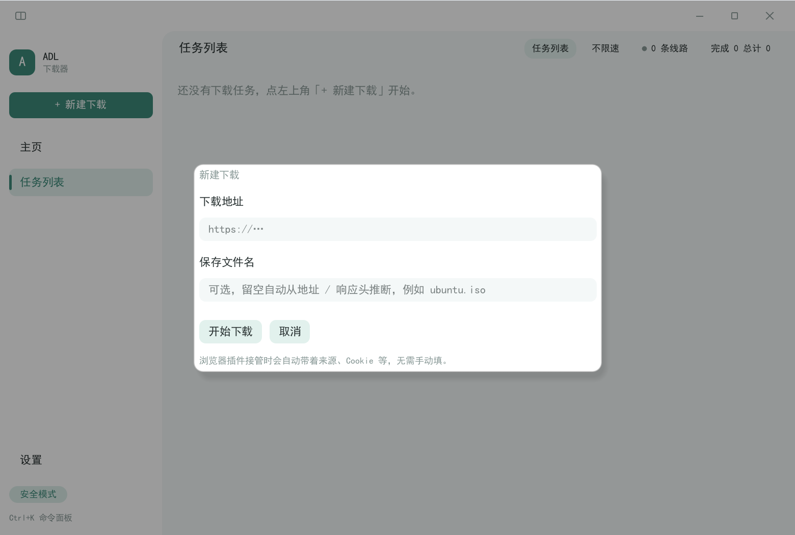
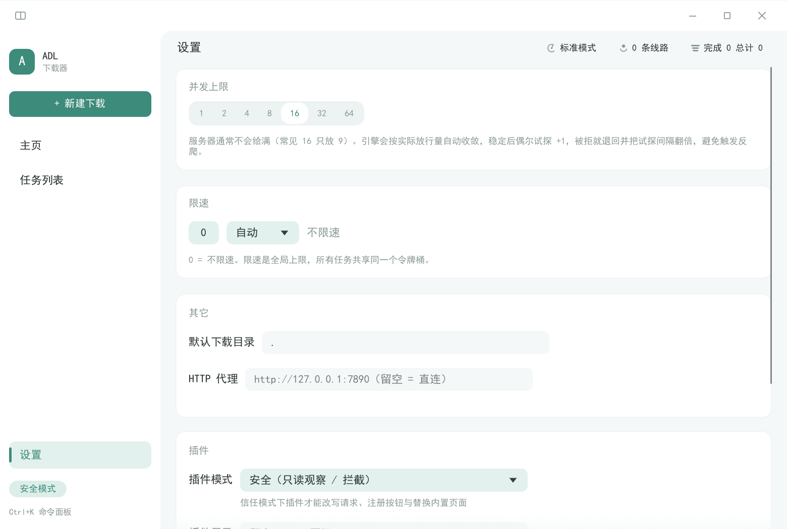
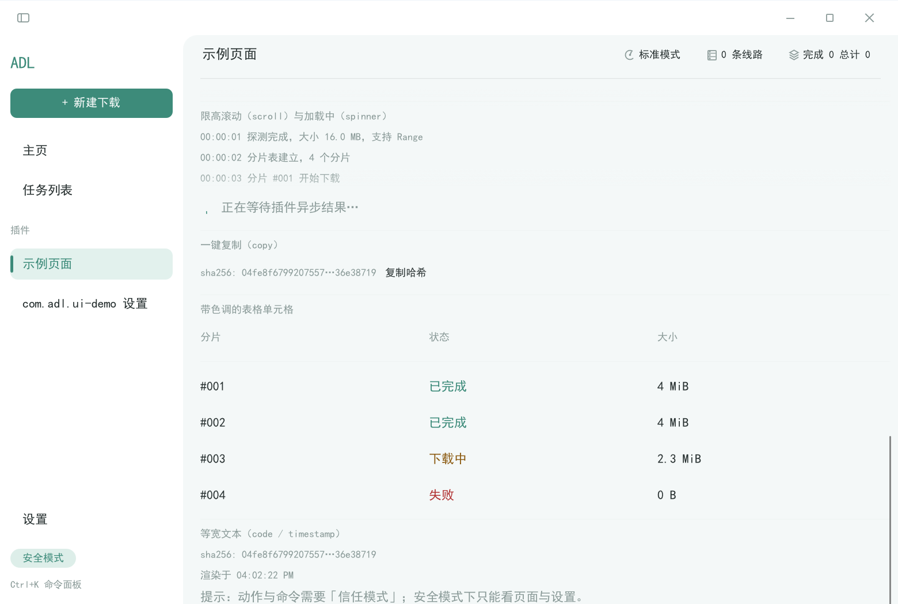

# ADL

一个**小型、快、插件优先**的 HTTPS 下载器。纯 Rust + LLVM，单文件 exe，绿色便携。

> 定位：自用向的轻量下载器（不是 aria2 的替代品）。核心是可靠的多连接分片下载、断点续传，以及一个能真正"插手"下载流程的插件系统。

## 特性

- **多连接分片下载**：把文件切成 1 MiB 的片，多 worker 并发拉取，单写者调度、两阶段抢占（慢连接不拖累整体）。
- **自适应并发**：`-x` 是"期望上限"（1–64，默认 16）。服务器只放行一部分时自动收敛到它接受的量，再隔一阵慢慢试探 +1；不会一直顶着上限猛冲触发反爬。
- **断点续传**：进度记在 `<文件>.adl` 里（原子写）。Ctrl+C 或用 `adl resume <id>` 都能接着下；服务器资源变了（ETag/Last-Modified 不符）会自动整单重下，不会写坏文件。
- **默认冒充浏览器 UA**：很多站点（百度网盘等反盗链）会直接拒绝 aria2 类的基础 UA。可用 `--user-agent` 覆盖。
- **重名不覆盖**：目标已存在时自动落成 `name (1).ext`；`--restart` 才显式覆盖。
- **服务器校验**：若响应带 `Digest`/`Content-Digest`(sha-256) 或 `Content-MD5`，下载完自动比对，不一致删文件报错；没有就不校验。
- **反爬保护**：连续 60 秒完全没有新字节 → 判定服务器停发（反爬/限速），保存进度后退出，不做无意义狂重试。
- **可选**：`--http1` 强制 HTTP/1.1、`--proxy` 走 HTTP 代理、`--limit` 限速。
- **插件系统（QuickJS）**：用 JavaScript 写，TOML manifest，9 个 hook 点（观察 / 拦截 / 改写）。安全模式默认只允许"观察 + 拦截"；信任模式才允许改写请求。

## 构建

需要 Rust 稳定版（本仓在 `rustc 1.99` / MSVC 工具链上开发）。Windows 上要能离线构建请确保本机有 VS 的 `cl.exe`（`rquickjs` 用它编译内嵌的 QuickJS C 源码）。

```bash
cargo build --release --target x86_64-pc-windows-msvc
# 产物：target/x86_64-pc-windows-msvc/release/adl.exe
```

体积优化已在 `Cargo.toml` 里配好（`opt-level="z"` + `lto="fat"` + `panic="abort"` + `strip`）。默认静态链接 CRT，不依赖 VC++ 运行库。

## 用法

```bash
adl <URL>                       # 下载（默认保存到当前目录）
adl <URL> -d D:\Downloads       # 指定目录
adl <URL> -o movie.mp4          # 指定文件名
adl <URL> -x 16                 # 期望最多 16 连接（默认 16）
adl <URL> --limit 5M            # 限速 5 MB/s
adl <URL> --http1               # 强制 HTTP/1.1
adl <URL> --proxy http://127.0.0.1:7890
adl <URL> -H "Referer: https://example.com/" -H "Cookie: ..."

adl list                        # 列出下载历史
adl resume <id>                 # 继续某条历史（断点续传）
adl remove <id> [--files]       # 删除历史记录（--files 同时删文件）
adl clean                       # 清空已完成的历史
adl config [--init]             # 查看/生成配置文件
```

### 配置文件

`adl config --init` 会在 `%LOCALAPPDATA%\ADL\config.toml`（或 exe 同级 `config.toml`，若存在则优先）生成模板：

```toml
dir = "."
connections = 16
chunk_size = 0        # 0 = 按文件大小自动分配
limit = 0             # 字节/秒，0 = 不限
user_agent = ""       # 空 = 内置浏览器 UA
http1 = false
proxy = ""            # 例如 "http://127.0.0.1:7890"
mode = "safe"         # safe | trusted
plugin_dir = ""       # 空 = exe 同级 plugins/
history_enabled = true
close_action = ""     # "" = 每次询问 | "tray" = 最小化到托盘 | "close" = 退出程序
limit_unit = "auto"   # auto | B/s | KB/s | MB/s | GB/s（只影响显示）
sidebar_collapsed = false
```

命令行的显式参数会覆盖配置里的同名项。

## 原生界面（纯 Rust · egui，不依赖 WebView2）✅ 推荐

`adl-gui.exe` 现在是 **纯 Rust 原生桌面界面**：`eframe`(`egui`)，**同时编入 glow(OpenGL) 与 wgpu 两套渲染后端**，**不需要 WebView2、不需要 Node/vite**，单个 exe，跨 Windows / Linux / macOS。


| 任务列表 | 后台任务下拉 |
|---|---|
|  |  |

| 添加下载（弹窗） | 设置 |
|---|---|
|  |  |

```bash
cargo build --release -p adl-gui
# 产物：target/release/adl-gui.exe（Windows 为 target/x86_64-pc-windows-msvc/release/adl-gui.exe）
```

- **主页**：四张统计卡（任务总数 / 已完成 / 失败 / 累计下载量）+ 下载热力图（年 / 月 / 周三档，数据来自 `history.json`）。
- **左右式外壳**：标题栏（左上折叠键 + 右侧窗口三键）与左侧栏同色连成一整块；内容区浅灰底、**左上角圆角**浮在上面。**不画装饰性分隔线**，边界全靠底色差；只有表头下沿保留一条 0.6px 的极淡线（`palette.hair`）。
- **顶栏 chips**：`标准模式`/限速档位（不限速时显示"标准模式"，点开可选 不限速 / 1·2·5·10 MB/s 直接切换）· `N 条线路`（进行中任务的活跃连接数之和）· `剩余 N / 完成 M`（点开是任务卡片列表，每行可点直接跳任务列表，右上角可「清空已完成」）。三个 chip 带手画图标（表盘 / 人形 / 堆叠），不依赖字体符号。
- **侧栏**：`+ 新建下载` → 主页 / 任务列表 → 插件分组（插件页面 + 最多 5 个插件设置入口，超出显示「更多设置…」）→ 底部「设置」与模式胶囊。**可收起**为 56px 图标条（用首字当图标）。
- **添加下载是弹窗**，不再是单独一页；地址框按 Enter 直接开始。
- **无边框窗口、自绘标题栏**：拖动、双击最大化、八向边缘缩放全部自己实现（`with_decorations(false)` 之后系统不再提供）。三个窗口按钮的图标用线段手画，不依赖字体符号。
- **关闭行为可选**：首次点关闭会问「最小化到托盘 / 退出程序」，可勾选记住；之后在设置里只能在这两项之间切换（问过就没有"每次询问"这个状态了）。
- **自研 UI 组件库 `crates/adl-ui`**：主题令牌化（换肤只改 `theme.rs`）、`Field`/`form()` 声明式表单、`Column`/`table()` 定宽表格（一列吃剩余、自带虚拟化）、`chip`/`segmented`/`heatmap`/`stat_card`/`window_button`/`hairline`/`nav_item`/`card` 等基础控件。新增一页设置只需几行 `Field`。
- 支持插件声明式 UI 页面（**23 个组件**：text/heading/badge/status/grid/stat/kv/table/progress/toggle/select/button…）、动作按钮、插件设置、命令面板（Ctrl+K）；插件组件树与本体的界面共用同一套视觉语言与主题令牌。
- 单实例（再次启动会唤醒已有窗口）、托盘（点托盘「显示主界面」恢复）、系统休眠自动暂停。
- 与 CLI 共用 `adl-core` 引擎、`adl-plugin` 插件、`adl-app` 配置/历史；浏览器接管 API 同进程运行。
- **设置项只给档位**：并发 7 档（1/2/4/8/16/32/64，本质仍是自适应）；限速 = 数值 + 单位（自动 / B/s / KB/s / MB/s / GB/s，用英文单位）。HTTP/1.1 不再由用户选（引擎自动）。

> **渲染后端可切换**（环境变量 `ADL_RENDERER`）：
> - 不设 / `glow`：OpenGL，**默认**，兼容性最好（虚拟机、远程桌面、老核显都能开）。
> - `wgpu`：自动选 Vulkan / DX12 / Metal 中可用的一个。
> - `vulkan`：wgpu 且强制 `WGPU_BACKEND=vulkan`（需要机器装了 Vulkan 驱动，否则拿不到适配器）。
>
> 为什么默认 glow：wgpu 后端在部分虚拟机 / 远程桌面环境会因 surface 丢失让进程静默退出；glow 稳定兜底。想要 Vulkan/DX12 时显式 `ADL_RENDERER=wgpu` 即可。

## 图形界面（M5 · 旧方案：tao + wry + WebView2，已弃用）

> 已被上面的「原生界面」取代，仅保留说明。旧的 `web/`（Vue）与 `static_server.rs` 不再编入。

`adl-gui.exe` 曾是基于 tao + wry（WebView2）的桌面窗口，前端是 Vue SFC + vite 构建。


```bash
cd web
npm run build          # 产出 web/dist（index.html + assets）
# 然后运行 adl-gui.exe（会启动 127.0.0.1:0 静态服务器托管 web/dist）
```

- 若 `web/dist` 不在默认查找位置，可用环境变量 `ADL_WEB_ROOT` 指过去。
- 改界面只需重建 `web/dist`，不必重编 Rust。
- 三个页面：任务列表（进度/速度/暂停/移除/删除文件）、添加下载、设置（目录/并发/限速/代理/插件模式/HTTP1）。

## 浏览器接管（M6）

ADL 启动后会监听本机 `127.0.0.1:17800`（可用环境变量 `ADL_API_PORT` 改），配合 `browser-extension/` 里的 MV3 扩展，把浏览器下载转交给 ADL。

- 安装：`edge://extensions` 或 `chrome://extensions` → 开启开发者模式 → 「加载解压缩的扩展」→ 选 `browser-extension/` 目录。
- 浏览器产生下载时，扩展调用本地 API `/add`；成功则取消浏览器原生下载，失败（ADL 未运行/接管关闭）则原样放行，不会丢链接。
- 需要登录的站：扩展会转发该 URL 的 Cookie。
- 安全：本地 API 只绑 127.0.0.1 + 随机 token + Origin 校验；细节见 `browser-extension/README.md`。
- 注意：ADL 需保持运行；支持**关闭到托盘**（关闭窗口不退出进程，托盘里点「显示主界面」可唤回）。未做剪贴板监听。

## 桌面集成（单实例 / 关闭到托盘 / 休眠唤醒）

- **单实例**：重复启动只会唤醒已在运行的窗口，不会开出第二个进程/第二份配置。
- **关闭到托盘**：可以在首次点关闭时选「最小化到托盘」，下载继续；托盘菜单「显示主界面」重新打开，「退出」才真正退出。想让它真的退出的就选「退出程序」（会先存进度，下次可续传）。
- **休眠/唤醒**：系统休眠前自动暂停进行中的任务（进度保存在 `.adl`）；唤醒后**不自动续传**，请手动继续（避免链接失效）。
- **无 WebView2 依赖**：界面是纯 Rust 的 egui 自绘（OpenGL / wgpu 双后端可选），不存在"系统缺 WebView2 就跑不起来"的问题。

## 插件

插件放在 `plugins/<id>/`，由 `plugin.toml` + `main.js` 组成。示例：

```toml
id = "com.example.hook"
name = "示例插件"
version = "0.1.0"
api_version = 1
entry = "main.js"
kind = "quickjs"

[[hooks]]
point = "onBeforeRequest"
priority = 100

[permissions]
notify = true

[limits]
timeout_ms = 3000
memory_mb = 32
```

```js
// main.js
adl.onBeforeRequest(function (ctx) {
  // ctx = { url, segIndex, start, end }
  return { action: "pass" };            // 或 { action: "deny", reason: "..." }
  //      或 { action: "rewrite", headers: { "User-Agent": "..." } }
});
```

- 9 个 hook 点：`onResolve` / `onPlan` / `onBeforeRequest` / `onResponse` / `onProgress` / `onRetry` / `onPreempt` / `onDegrade` / `onComplete`。
- **安全模式**：`--safe`（默认）只允许 Observe（观察类）+ Guard（拦截类，只能放行/拒绝）；`--trusted` 才允许 Transform（改写 URL / 请求头 / 分片方案）。默认从配置文件 `mode` 读取。
- 权限**声明 ≠ 授权**：manifest 里声明了才可能被允许，未声明的调用一律拒绝并审计。
- 详见 [plugins/README.md](plugins/README.md)。内置示例：`ua-fixer`、`auto-concurrency`、`notify-on-complete`、`block-html`、`ui-demo`。

## 插件 UI 扩展点

插件不仅能改下载行为，还能改**界面本身**（"插件为大"）。插件返回**声明式 JSON 组件树**，由宿主用白名单渲染器画成真实界面——插件**拿不到 DOM、不能注入 `<script>`、读不到 cookie**。

manifest 里加 `[ui]` 段即可：

```toml
[[ui.pages]]
id = "demo"
title = "示例页面"

[[ui.actions]]
id = "hello"
label = "示例动作"
place = "toolbar"

[[ui.settings]]
key = "greeting"
label = "问候语"
kind = "string"
default = "你好"

[[ui.commands]]
id = "say-hi"
title = "示例：打个招呼"
```

```js
adl.onUiRender((req) => ({
  type: "col",
  children: [
    { type: "heading", value: "示例页面" },
    { type: "progress", value: 42, total: 100 },
    { type: "button", label: "点我", action: "hello" },
  ],
}));
adl.onAction((req) => ({ message: "动作：" + req.action }));
adl.onCommand(() => ({ message: "命令响应" }));
```

- 组件白名单：`text/label/heading/badge/status/divider/spacer/row/col/card/button/input/select/toggle/progress/list/kv/stat/grid/table/link/code/timestamp`（共 23 种，未知类型画成 `[xxx]` 不报错）。
- **分级**：`safe` 只给页面（只读）与设置项；`trusted` 才给动作、Ctrl+K 命令、可编辑设置，以及"替换内置页面"（`replaces = "tasks|add|settings"`）。
- 设置存储分两处：主 `config.toml` 只存每插件 `enabled` 开关；详细设置在各插件自己的 `plugin-settings/<id>.json`。
- 颜色只能用语义名（`accent`/`warn`/`danger`/`muted` 及别名 `primary`/`ok`/`completed`/`paused`/`error`/`failed`），**不能写 RGB** —— 否则换主题时插件就成了硬编码补丁。
- 示例见 `plugins/ui-demo/`。



## 状态

- ✅ M1 单流 + 断点续传
- ✅ M2 并发分片 + 限速 + 重试 + 自适应降档
- ✅ M3 插件系统（QuickJS + TOML manifest + 权限 + 安全模式）
- ✅ M4 CLI 完整（配置 + 历史 + 子命令），v0.1 可用
- ✅ M5 图形界面（先 wry + WebView2 + Vue；**已迁移为纯 Rust 原生界面 egui，不再依赖 WebView2**）
- ✅ M6 浏览器接管（MV3 扩展 + 本地 API，未做剪贴板）
- ✅ 插件 UI 扩展点（页面/动作/设置/命令，trusted 可替换内置页面）
- ✅ 桌面集成（单实例 + 关闭到托盘 + 休眠/唤醒自动暂停）
- ✅ 原生 UI（egui + glow/wgpu 双后端可选，跨 Windows/Linux/macOS，无 WebView2）
- ✅ UI 左右式布局（侧边栏 + 顶栏 + 内容区，Motrix 浅色主题）
- ✅ 自研 UI 组件库 `crates/adl-ui`（主题令牌 + 声明式表单 + 定宽表格，三页已迁移）
- ✅ 无边框窗口 + 自绘标题栏（拖动 / 双击最大化 / 八向缩放全部自实现，不依赖字体图标）
- ✅ 插件渲染器 23 个组件（grid/stat/kv/table/status…，语义 tone，未知类型降级不崩）
- ✅ 外壳重构（顶栏 chips + 主页热力图 + 添加下载弹窗 + 侧栏可收起 + 关闭行为可记忆）

设计文档见 [docs/DESIGN.md](docs/DESIGN.md)。

## 许可

MIT，见 [LICENSE](LICENSE)。

## 免责声明

本项目为个人自用工具，按"现状"提供，不保证适用于任何特定用途。请遵守你所在地区法律与目标网站的服务条款，仅下载你有权下载的内容。
